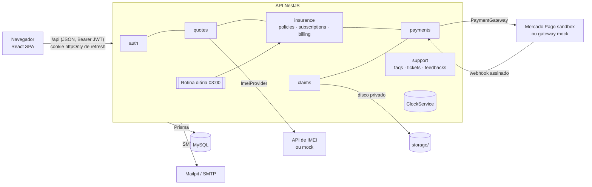
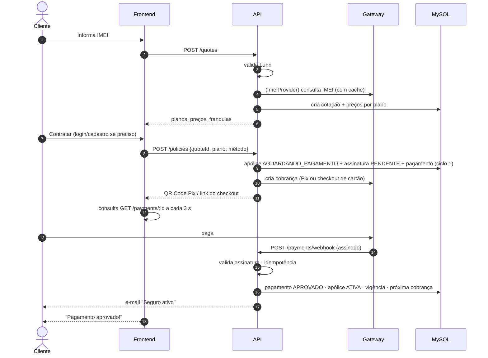
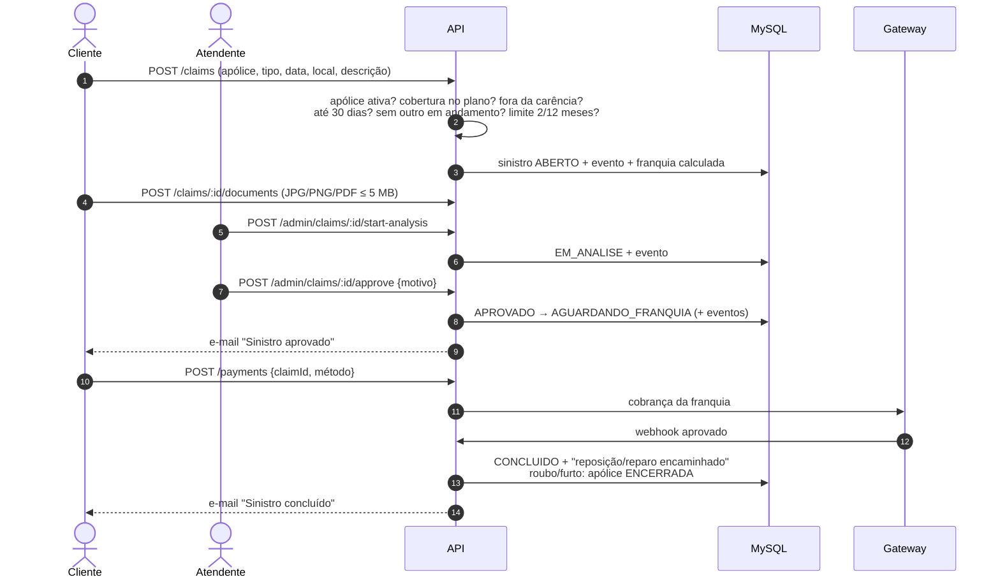

# Arquitetura e fluxos principais

## Visão geral



**Decisões principais**

- **Integrações atrás de interfaces** (`ImeiProvider`, `PaymentGateway`): o sistema funciona e é testado com mocks, e a troca para o serviço real é só configuração (`IMEI_PROVIDER`, `PAYMENT_GATEWAY`).
- **Módulos sem dependência circular:** `payments` não conhece apólices nem sinistros. Os módulos `insurance` e `claims` registram *handlers* (`PaymentHandler`) que reagem quando uma mensalidade ou franquia é aprovada ou recusada.
- **Idempotência em três camadas:** (1) `webhook_events` guarda os ids dos eventos já processados; (2) o status do pagamento só muda se ainda estiver `PENDENTE` (update condicional); (3) a unicidade de `(assinatura, ciclo, tentativa)` impede que a rotina cobre duas vezes o mesmo ciclo.
- **Relógio injetável (`ClockService`):** toda regra de negócio usa `clock.now()`. Os testes fixam a data e a demonstração avança o tempo. Expiração de sessão e de links usa o tempo real.
- **Funções puras** para preço, franquia, elegibilidade e transições de status (`pricing.ts`, `transitions.ts`), todas cobertas por testes unitários.
- **Segurança:** argon2 nas senhas; JWT de 15 min; refresh token rotativo (hash SHA-256 no banco, cookie `httpOnly; SameSite=Lax`, path `/api/auth`); guards globais de autenticação e papel; checagem de dono em todo recurso; `helmet`; CORS restrito ao frontend; limites de requisição (login 5/min, cotação 10/min); upload validado pelo conteúdo do arquivo (*magic bytes*) e servido só ao dono ou admin; nenhum dado de cartão passa pela API.

## Sequência – compra e pagamento



## Sequência – renovação automática

```mermaid
sequenceDiagram
    autonumber
    participant R as Rotina diária
    participant A as BillingService
    participant G as Gateway
    participant D as MySQL
    R->>A: runDaily(clock.now())
    A->>D: assinaturas ATIVA/INADIMPLENTE/SUSPENSA
    alt 5 dias antes do vencimento
      A-->>A: e-mail de aviso (uma vez por ciclo)
    end
    alt 3 dias antes e sem cobrança do próximo ciclo
      A->>D: pagamento (ciclo+1, tentativa 1) — único
      A->>G: cobrança (cartão: débito; Pix: novo QR por e-mail)
    end
    alt venceu sem pagamento
      A->>D: assinatura INADIMPLENTE (D0)
    end
    alt D3 / D7
      A->>G: nova tentativa (2 / 3)
    end
    alt D10
      A->>D: assinatura e apólice SUSPENSA
    end
    alt D30
      A->>D: CANCELADA · expira cobranças pendentes
    end
    G-->>A: pagamento aprovado (webhook)
    A->>D: ciclo+1 · vigência estendida · ATIVA
```

## Sequência – acionamento do seguro


