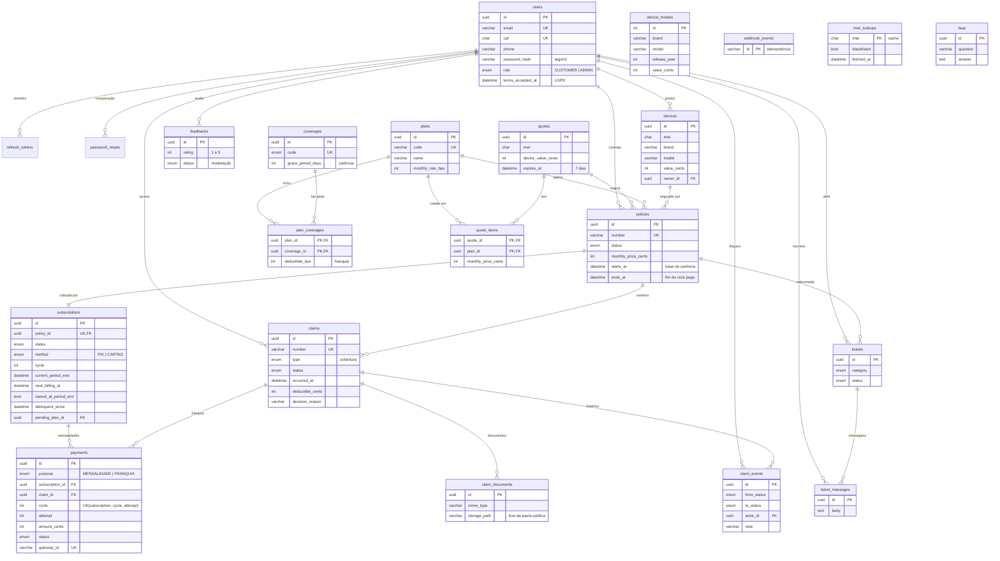
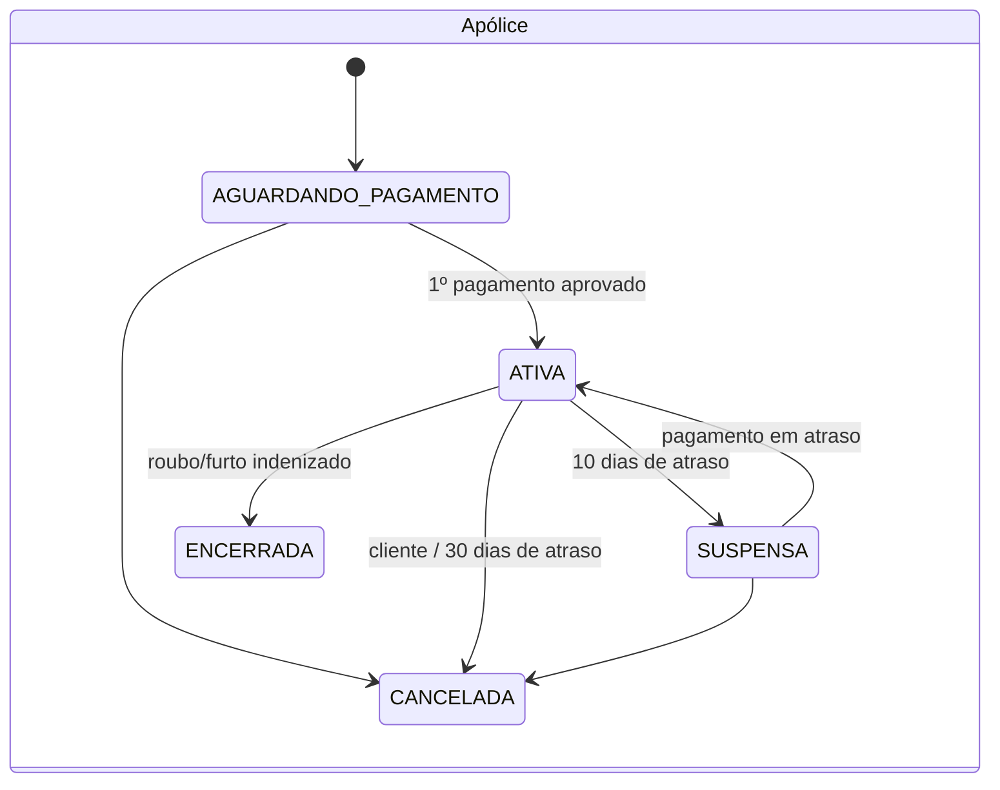
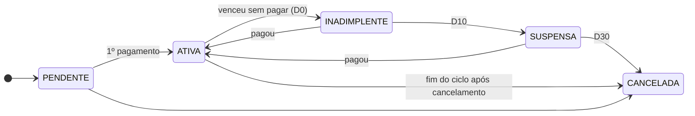
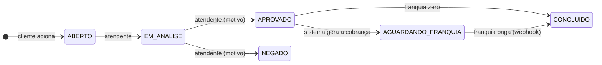

# DER – Seguradora de Celular

Fonte da verdade: [`backend/prisma/schema.prisma`](../backend/prisma/schema.prisma). Valores monetários em **centavos** (`INT`), percentuais em **basis points** (1% = 100), datas em UTC.

## Status e transições permitidas

Implementadas em [`backend/src/domain/transitions.ts`](../backend/src/domain/transitions.ts) (com testes).

## Índices relevantes

- `policies(user_id, status)`, `claims(user_id, status)`, `claims(status, created_at)`, `tickets(user_id, status)`, `tickets(status, updated_at)`, `subscriptions(status, next_billing_at)`, `devices(imei)`, `claim_events(claim_id, created_at)`, `feedbacks(status, created_at)`.
- Únicos que garantem regras: `users.email`, `users.cpf`, `payments(subscription_id, cycle, attempt)` (não cobra duas vezes o mesmo ciclo), `payments.gateway_id`, `webhook_events.id` (evento processado uma vez).
